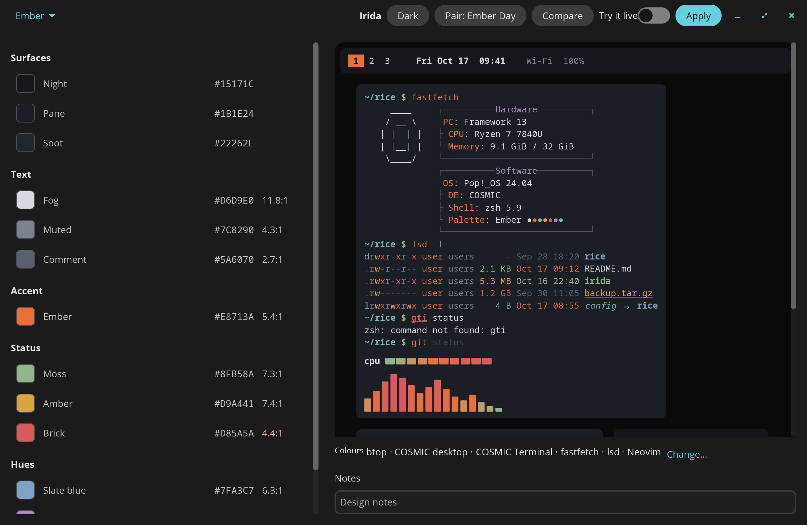
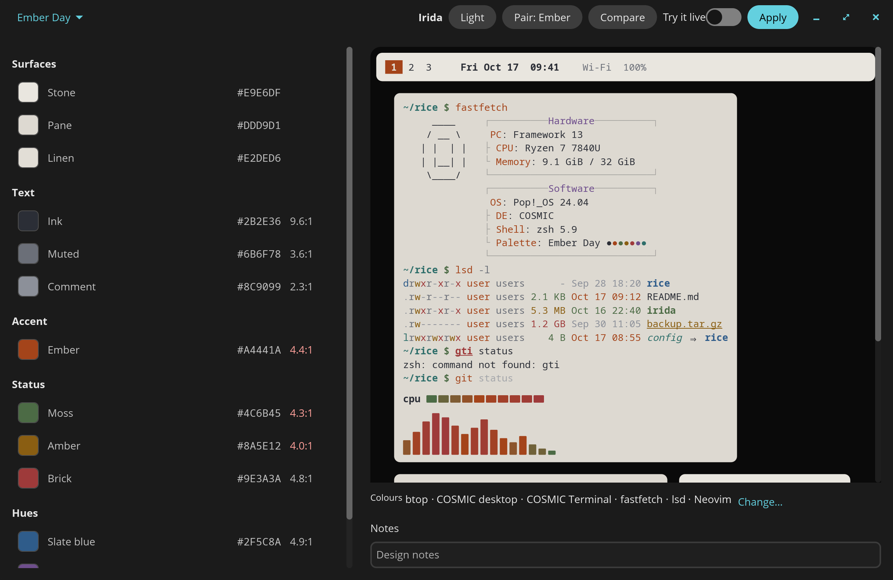

<div align="center">


# Irida

Design a colour palette and apply it to COSMIC and the apps around it.


</div>

---



Irida is a palette designer for the COSMIC desktop, named after Iris, the Greek
goddess of the rainbow. A palette is 13 roles (background, text, accent, the
semantic and ANSI colours); Irida keeps every one readable and writes the
result to your desktop, terminal, editor and tools in one step.

## Features

- **Edit with live feedback.** Change any role by hand; the preview of the
  desktop, terminal, Neovim, btop and cava and every contrast ratio follow at
  once.
- **Draft from a wallpaper.** Pick an image and get a dark or light palette
  whose roles already pass their contrast minimums.
- **Apply and undo.** One step writes every installed app; one step puts back
  exactly the files it changed.
- **Try it live.** Watch the desktop and terminal change while you edit, then
  Keep or Revert. A crash mid-session offers Revert on the next start.
- **Pairs, versions and snapshots.** Link a dark and a light palette, compare
  with any saved version, and pin the ones worth keeping.
- **Import and export rices.** Open an existing `cosmic-*-theme` repository, or
  export a palette as a complete one.



## Supported apps

| App | What Irida writes | Live |
|-----|-------------------|:----:|
| COSMIC desktop | Dark or light theme colours and the mode; your radii, gaps and frosting stay | ✓ |
| COSMIC Terminal | Its own colour scheme and profile | ✓ |
| cava | The colour block in `~/.config/cava/config` | ✓ |
| btop | `themes/irida.theme`, selected in `btop.conf` | |
| Neovim | `colors/irida.lua` | |
| fastfetch | `config.jsonc` and its logo | |
| lsd | `colors.yaml` and `config.yaml` | |
| zsh | A marked block in `~/.zshrc` | |
| Ghostty | `themes/irida`, selected in `config` | |

Apps that are not installed are skipped. To add your own, put a folder with a
`target.toml` and its templates in `~/.config/irida/targets/`; the built-in
ones in [`irida-core/targets`](irida-core/targets) are the examples.

## Install

Download `irida_0.1.0-1_amd64.deb` from the
[latest release](https://github.com/atraxsrc/irida/releases/latest) and install
it:

```sh
sudo apt install ./irida_0.1.0-1_amd64.deb
```

Irida then shows in the launcher. The window needs a graphical session; the
commands below work anywhere.

## Use

`irida` with no arguments opens the app. The same binary has these commands:

| Command | What it does |
|---------|--------------|
| `irida check <palette>` | Contrast table against the background and pane; exit 1 on a failure |
| `irida apply <palette> [--only btop,nvim]` | Write the palette to every installed app, or only the ones named |
| `irida undo` | Put back the files from the most recent apply |
| `irida export <palette> <folder>` | Write a `cosmic-<slug>-theme` rice repository |
| `irida draft <image> [--mode dark\|light] [--name NAME]` | Make a palette from a JPEG, PNG or WebP image and save it |
| `irida list` | List the saved palettes |

`<palette>` is a saved palette's slug, a path to a `palette.toml`, or a rice
repository folder.

### Where things live

| Path | What |
|------|------|
| `~/.local/share/irida/palettes/<slug>/` | Each palette, its saved versions and snapshots |
| `~/.config/irida/settings.toml` | App settings, such as the last open palette |
| `~/.config/irida/targets/` | Your own targets |
| `~/.local/state/irida/` | Apply records for undo, and the live session while one runs |

The `XDG_DATA_HOME`, `XDG_CONFIG_HOME` and `XDG_STATE_HOME` variables are
honoured when set.

## Build

Irida needs Rust 1.93 or newer and the libraries libcosmic builds against. On
Ubuntu or Pop!_OS:

```sh
sudo apt install pkg-config libxkbcommon-dev libwayland-dev libexpat1-dev \
    libfontconfig-dev libfreetype-dev cmake
cargo build --release
```

To build the .deb, install cargo-deb (`cargo install cargo-deb --locked`) and
set the maintainer for this build only, as `Your Name <you AT example.com>`
with a real at-sign in place of `AT`:

```sh
DEB_MAINTAINER="..." scripts/deb.sh
scripts/check-deb.sh target/debian/irida_0.1.0-1_amd64.deb
```

`scripts/check-deb.sh` checks the files and their modes, the desktop entry,
the AppStream data and, when it is installed, lintian.

## License

MIT, see [LICENSE](LICENSE).
