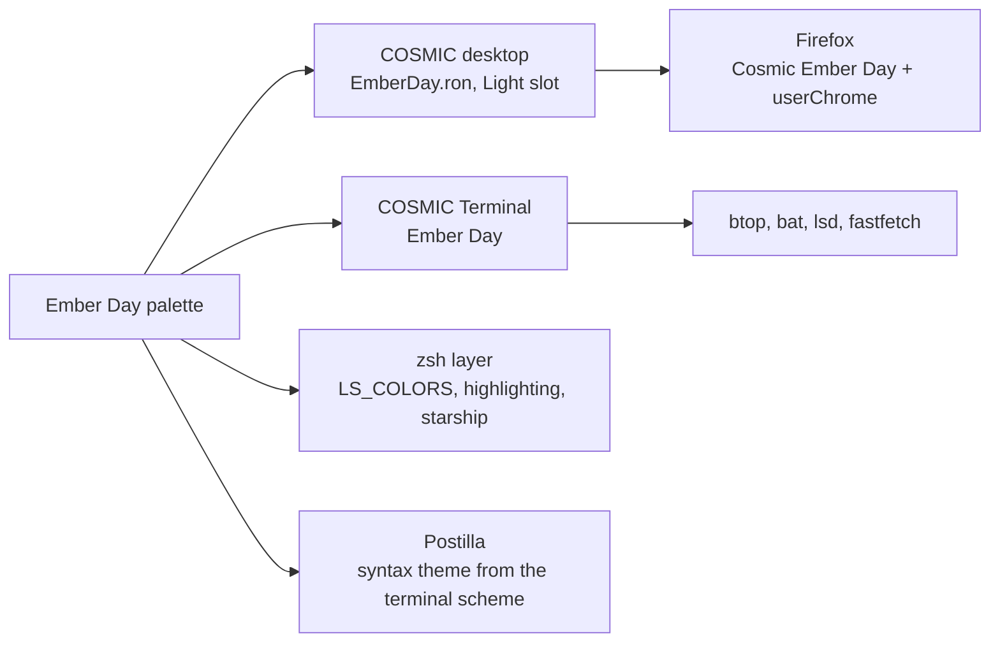

# Ember Day

> Stone, ink and one ember. The light half of Ember / Ember Day.

Pop!_OS 24.04 on the COSMIC desktop, one palette carried through the whole
machine: desktop, terminal, shell, editor, browser. This note is the rice
describing itself, written in Markdown and rendered by **Postilla**.

## Palette

Every text colour is checked against the window background `#E9E6DF`.

| Role | Hex | Contrast on background |
|------|-----|------------------------|
| Text | `#2B2E36` | 10.9:1 |
| Ember, accent | `#A4441A` | 4.9:1 |
| Moss, success | `#4C6B45` | 4.8:1 |
| Amber, warning | `#8A5E12` | 4.6:1 |
| Brick, error | `#9E3A3A` | 5.4:1 |
| Heather, magenta | `#6E4E8C` | 5.4:1 |
| Verdigris, symlinks | `#2E6E6A` | 4.7:1 |

Containers sit one step away from the background at `#E2DED6`, which is
what frosted glass blurs into. The terminal is the exception: an opaque pane
at `#DDD9D1`, one step darker than the desktop.

## Where the colours go



## Setup, in order

- [x] Import `cosmic/EmberDay.ron` into Appearance, **Light** slot
- [x] Import `cosmic-term/EmberDay-term.ron`, pick **Ember Day** for the profile
- [x] `./icons/install.sh` for the **Cosmic-EmberDay** icons, `./cosmic/install.sh` for fonts and the terminal look
- [x] `./zsh/install.sh`, `./lsd/install.sh`, `./fastfetch/install.sh`
- [x] Cursor: Oxygen-EmberDay-Ember
- [x] Wallpaper: `backgrounds/emberday-anime.png`
- [x] Screenshot for the README

## The baseline every rice shares

```ron
corner_radii: (
    radius_xs: (2.0, 2.0, 2.0, 2.0),   // squared corners
    radius_xl: (2.0, 2.0, 2.0, 2.0),
),
frosted: Low,
frosted_windows: true,
frosted_panel: true,
frosted_applets: true,
frosted_maximized_apps: false,
gaps: (0, 7),
active_hint: 1,
```

Contrast is the WCAG ratio[^1], where $L$ is relative luminance:

```typst
$ (L_1 + 0.05) / (L_2 + 0.05) >= 4.5 $
```

---

*Rendered in Postilla, a Markdown notes app for COSMIC. The window is painted
with this rice's terminal scheme, imported as a syntax theme.*

[^1]: Web Content Accessibility Guidelines, success criterion 1.4.3. Normal text wants 4.5:1, large text 3:1.
